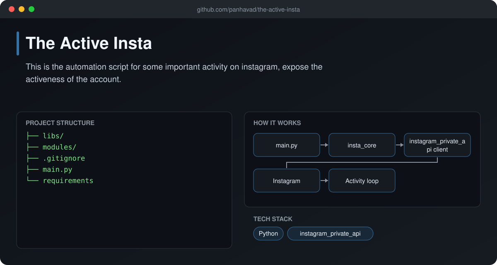
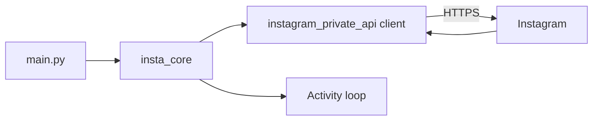

# The Active Insta

  [](https://github.com/panhavad/the-active-insta/releases/latest)

An **Instagram automation script** that performs routine account activity to keep an account active, built on a bundled copy of `instagram_private_api` / `instagram_web_api`.



## Features

- Login and session handling
- Automated feed / user activity
- Core logic in `modules/insta_core.py`
- Bundled API client libraries in `libs/`

## How it works



## Getting started

```bash
python main.py
```

## Download

Grab the packaged source from the [latest release](https://github.com/panhavad/the-active-insta/releases/latest).

## Tech stack

- Python
- instagram_private_api

## Project structure

```text
the-active-insta/
├── docs/
├── libs/
├── modules/
├── .gitignore
├── main.py
├── README.md
└── requirements
```
